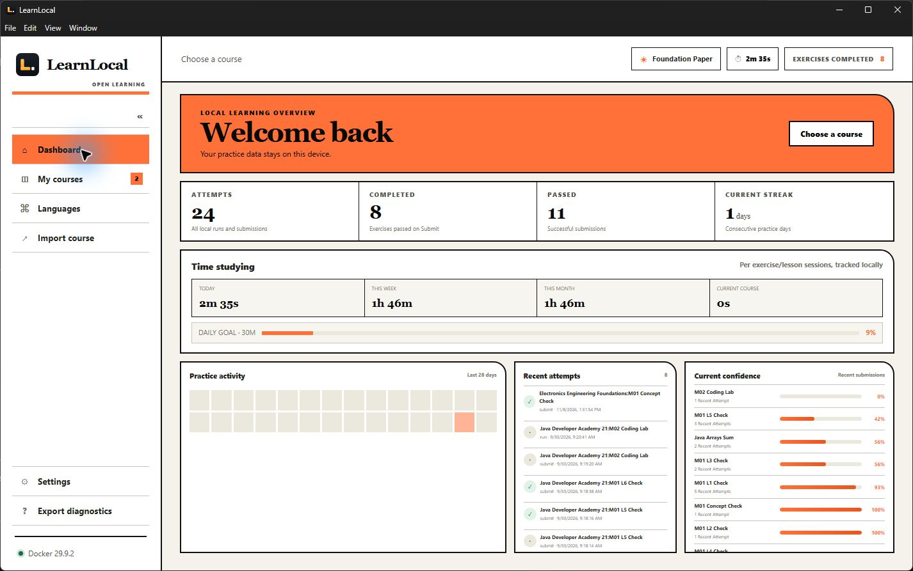
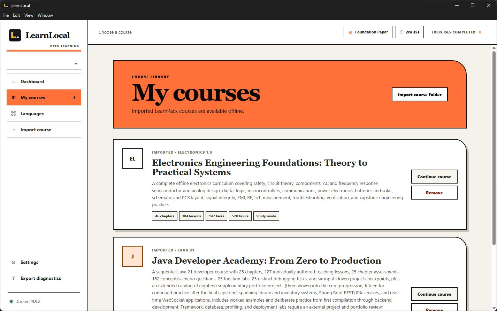
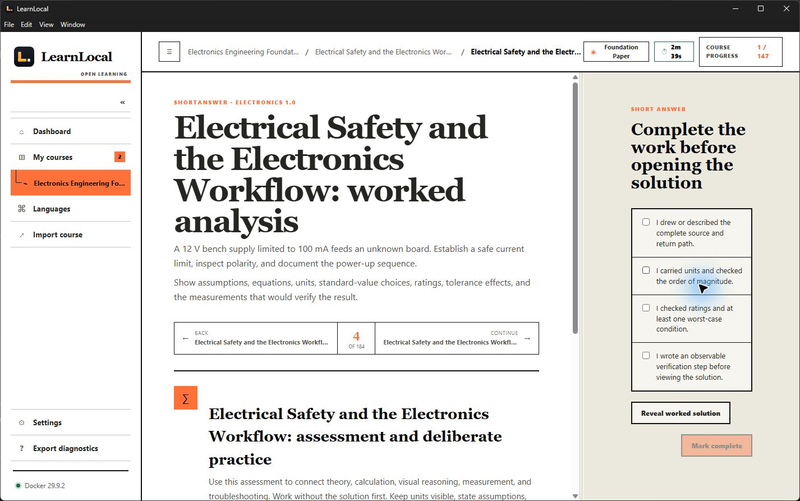
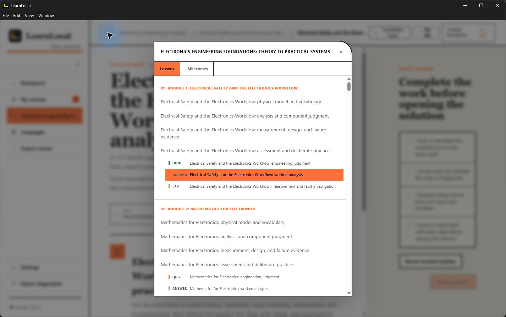

<p align="center"></p>

# LearnLocal

**Deep, practical learning for anyone, regardless of internet access or budget.**

LearnLocal is an offline-first desktop application for structured technical learning. Import a course once, and everything after that—reading lessons, studying diagrams, completing calculations and labs, taking quizzes, writing and running supported code, and tracking progress—works locally with no account or subscription.

## Download

Grab the latest Windows build from the [Releases page](https://github.com/escaper01/learn_local/releases):

- **`LearnLocal-<version>-x64.exe`** — a normal installer (Start Menu shortcut, uninstaller).
- **`LearnLocal-Portable-<version>-x64.exe`** — no installation. Copy it anywhere (including a USB drive) and run it directly; it stores its database, courses, and settings in a `LearnLocal-Data` folder next to the executable, so the whole thing stays self-contained.

**Docker Desktop (or Docker Engine) is only required for executable programming exercises.** It runs Java submissions in disposable, network-disabled containers. Reading, quizzes, guided calculations, electronics labs, solutions, projects, and progress tracking work without Docker.

### Importing the bundled courses

Every release includes two offline curricula:

- **`javaCourse.zip`** — Java Developer Academy, with 25 chapters and 152 lessons from first compilation through production-oriented backend engineering.
- **`electronicsCourse.zip`** — Electronics Engineering Foundations, with 46 chapters and 184 lessons covering theory, components, circuit analysis, measurement, microcontrollers, PCB design, power electronics, RF, IoT, troubleshooting, and capstone work.

1. Download either course ZIP from the same [release](https://github.com/escaper01/learn_local/releases) and extract it anywhere on disk (right-click → **Extract All…**).
2. Open LearnLocal and click **Import course folder**.
3. In the folder picker, locate and select the folder you just extracted (the one containing `manifest.json`).

LearnLocal validates the folder and adds it to **My courses**. The same steps work for any other LearnPack course folder you obtain elsewhere — see [Course content](#course-content) below for authoring your own.

## Why LearnLocal exists

Most modern ways to learn programming — interactive platforms, video subscriptions, cloud IDEs — assume you have fast, affordable, always-on internet and can pay a recurring fee. That assumption doesn't hold everywhere. LearnLocal is built for:

- **Learners with unreliable or expensive internet** — download a course once (or get it from someone who already has it, on a USB drive if needed), and learn entirely offline from then on.
- **Learners who can't justify a monthly subscription** — LearnLocal itself is free and requires no account. Courses are portable files you own, not a rented catalog.
- **Anyone who wants their code and progress to stay on their own machine** — nothing is uploaded anywhere. Ever.

Today, LearnLocal ships with trusted, sandboxed **Java 21** execution plus complete Java and Electronics curricula. Course content for any subject or language can be imported and studied; executable exercises only run when LearnLocal contains a reviewed adapter for that runtime.

## A tour of the app

| | |
|---|---|
|  **Dashboard** — the complete learning overview fits in one desktop window, including activity, attempts, confidence, streaks, and study time. |  **My Courses** — a detailed offline library for programming and study-mode curricula. |
|  **Guided technical work** — theory, calculations, labs, checklists, and worked solutions appear together. |  **Course outline** — navigate lessons, typed exercises, and milestone projects with clear task labels. |

## Feature overview

**Learning experience**
- Reading lessons, typed exercises (function, debug, output, multi-file project checkpoints), and multiple-choice concept checks, all in one continuous course flow with a "Next" step after every correct answer or passing submission.
- A 75/25 reading-pane/editor split by default, resizable and remembered.
- A "Course topics" modal for jumping between lessons and milestone projects without leaving the workspace.
- Progressive hints with a configurable reveal delay.
- Public tests for **Run**, hidden tests for **Submit**, normalized pass/fail results, and bounded execution time/memory/output.

**Time tracking & progress**
- A live study timer that counts your time today without resetting when you switch lessons.
- Per-course and per-chapter time breakdowns, a daily study goal with progress, attempts/streak/confidence stats — all computed locally from raw session data, never estimated.

**Appearance**
- An editorial desktop design system with strong typography, compact information density, accessible contrast, and consistent native branding.
- Built-in light and dark themes plus custom theme duplication and color editing.
- Matching syntax colors for Monaco and lesson code blocks, with adjustable editor font size.

**Course content**
- Import a course by pointing at its folder directly — no archive format to trust, validated against the LearnPack 1.0 schema (path traversal, symlink, and size-limit checks included).
- Author or extend a course directly in the repository, using `examples/javaCourse/` as the reference curriculum, then import its folder.
- Arbitrary-language course content is always importable for reading and quizzes; trusted code execution is available wherever a reviewed adapter exists (Java 21 today).

**Runtime management**
- Independent install/verify/update/remove for the Java runtime, with live `docker pull` progress shown instead of a silent spinner.
- Offered automatically the first time you open a course that needs it — dismissible, so you can keep reading before installing anything.

**Privacy & security**
- No account, no telemetry, no network calls except pulling the approved, digest-pinned Docker image you explicitly install.
- Code runs in a fresh, disposable, network-disabled container per attempt — no container is ever kept running, and none are created just by installing or browsing.
- Strict Electron sandboxing: no Node or raw IPC access from the renderer, validated IPC payloads, CSP, navigation guards.

**Everything else**
- Local SQLite storage for attempts, workspaces, settings, custom themes, and time tracking, with versioned migrations and automatic backup-before-migration.
- Global settings (editor font size, hint delay, runtime auto-install offer, daily study goal, timer visibility) — one place, no per-course overrides to manage.
- A diagnostics export that bundles application/platform info, Docker status, database health, learning and time-tracking summaries, imported course list, current settings, and appearance state into one JSON file for troubleshooting.
- Cross-platform packaging (Windows/macOS/Linux) and CI.

## Prerequisites

- Node.js 22+
- Docker Desktop or Docker Engine (only needed to *run* code — reading courses and quizzes work without it)

## Development

```bash
npm install
npm run dev
```

**Run** executes public tests, while **Submit** also executes hidden tests. Each compile and test run uses a restricted, disposable container built from an approved digest-pinned image. The normal execution path opens no TCP port.

## Checks

```bash
npm run check
```

The first Docker execution may take longer while the pinned Java image is downloaded.

Run the real-container conformance suite after runner or sandbox changes:

```powershell
$env:RUN_DOCKER_TESTS='1'
npx vitest run packages/sandbox-docker/src/docker.integration.test.ts
```

## Packaging

```bash
npm run pack   # unpacked application for local validation
npm run dist   # platform installer
```

Installer output is written to `release/`. The manual packaging workflow builds Windows, macOS, and Linux artifacts. Public trusted releases still require repository-owner signing credentials and an update distribution endpoint.

## Course content

The repository includes a small canonical import fixture at `learnpack-spec/examples/java-foundations/` and a full Java 21 developer academy under `examples/javaCourse/`. The academy contains 25 chapters, 152 sequential lessons, 226 exercises and checkpoints, an extended portfolio catalog, and a production-minded capstone. It progresses from first compilation through the JVM, language fundamentals, algorithms, object design, testing, builds, concurrency, networking, SQL/JDBC, architecture, security, Spring/JPA, distributed systems, and operations.

The repository also includes `examples/electronicsCourse/`, a 46-module, 184-lesson Electronics Engineering Foundations curriculum with offline circuit diagrams, component and instrument imagery, worked calculations, guided simulations and labs, troubleshooting investigations, phase projects, and a final system capstone. It covers safety, circuit analysis, passive and semiconductor components, AC and frequency response, analog and digital design, microcontrollers and protocols, power electronics, batteries and solar, schematics and PCB layout, signal integrity, EMI, RF, IoT, measurement, and engineering verification. Build, verify, and package it with `npm run curriculum:electronics:build`, `npm run curriculum:electronics:verify`, and `npm run curriculum:electronics:package`.

Every file under `examples/javaCourse/` is independently authored curriculum and is the source of truth: `content/` holds the chapter structure and exercises, `lessons/` holds each lesson's long-form Markdown theory (referenced from the chapter JSON by `theoryFile`), and `projects/` holds the portfolio phases. There is no curriculum-content generator. The pack distinguishes runnable standard-library exercises from external database/framework/deployment work and reviewer-assessed portfolio requirements. Checkpoints test behavior; they do not certify professional mastery.

**Importing a course**: in the app, click **Import course** and select a course's folder directly (for example `examples/javaCourse/`) — LearnLocal validates it against the LearnPack 1.0 schema on import. There is no archive/zip step; importing a folder directly is a deliberate security choice (a zip renamed to a custom extension is not a meaningful trust boundary).

A packaged Java archive can be built with `npm run curriculum:package`; build Electronics with `npm run curriculum:electronics:verify && npm run curriculum:electronics:package`. These commands create ignored release outputs at the repository root. The reviewed directories under `examples/` remain the authoring sources.

To add a topic with Codex, Claude, or another coding agent, give it access to this repository and follow the detailed [course and topic authoring guide](docs/learnpack-authoring.md). It covers planning, progression, stable IDs, manifests, lesson writing, every exercise type, solutions and tests, projects, diagrams and images, versioning, validation, packaging, and import. The agent should edit the curriculum source directly rather than recreating an in-app generation workflow.
